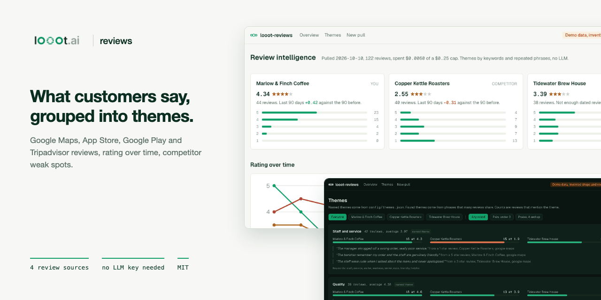
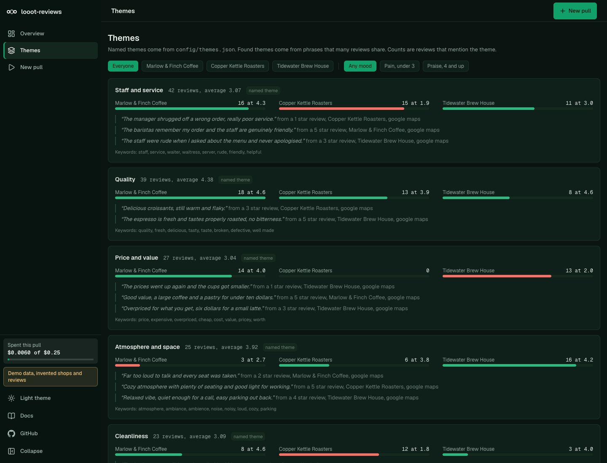
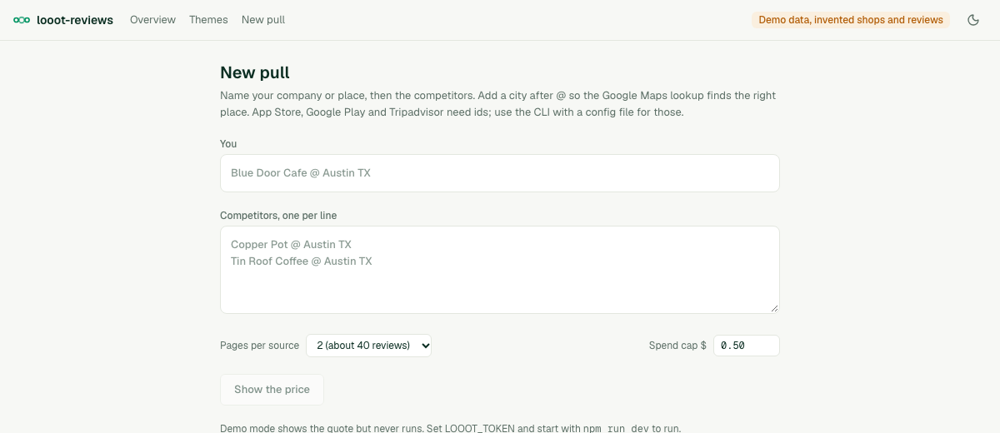

<p align="center"></p>

# looot-reviews

[](LICENSE) [](https://github.com/loootai/looot-reviews/releases) [](https://docs.looot.ai)

An open-source alternative to paid review monitoring such as ReviewTrackers, and to reading Google, App Store and Tripadvisor reviews by hand. ReviewTrackers' pricing page, read on 2026-10-10, says plans start "per location per month, paid annually" but did not show the amount to a browser, so no number is quoted here. This repo reads reviews on demand through one looot key and charges per call. A pull of five companies on Google Maps, two pages each, is at most $0.015 at list prices.

Name your company or place and its competitors. looot-reviews pulls their reviews, groups them into themes with counts and example quotes, tracks the average rating by month and lists the themes where a competitor's customers are unhappy and yours are not.




The demo data is invented. Marlow & Finch Coffee, Copper Kettle Roasters and Tidewater Brew House do not exist, and every review was generated from sentence templates. The patterns in it (Copper Kettle is slow and its rating falls, Tidewater is expensive) were planted so the screens have something to show.

## What you need

- Node 22.12 or newer. `package.json` has no `engines` field. Next.js 16 needs 20.9 or newer and the test runner (vitest 5) needs 22.12 or newer. I ran everything below on Node 24.
- npm. Nothing else for the demo and for `--dry-run`.
- A looot account and an agent token, only for a real pull. Sign up at https://looot.ai/auth/sign-up. To get a token, run `npm i -g looot` and then `looot login`, which opens a browser approval. Or open the looot web app, go to Settings, "Agent tokens" and create one (https://docs.looot.ai/get-started/sign-in). With no browser, create the token there and `export LOOOT_TOKEN=...`.
- The token needs the scopes `runs.execute`, `catalog.read`, `runs.read` and `usage.read`.
- A funded balance. A run needs prepaid credit, the minimum top-up is $5, and signing up adds no credit (https://docs.looot.ai/money).
- Optional, an LLM API key for the theme merge step (see "Optional LLM step"). Off by default.

There is no Supabase in this repo. The web UI has one admin password, see "Securing a deployment".

## Try it in one minute

No account and no token.

```bash
git clone https://github.com/loootai/looot-reviews.git
cd looot-reviews
npm install --ignore-scripts
npm run demo
```

The web UI opens at http://localhost:3240 (`next dev -p 3240`) with invented shops. `/new` shows the quote page, and in demo mode the run button makes no looot call. The demo has no sign-in and shows a "Demo, no sign-in" badge. `npm run demo` and the app both refuse to open it next to a `LOOOT_TOKEN`, a `REVIEWS_LLM_API_KEY` or a saved pull, unless an admin password is set. If port 3240 is busy, run `NEXT_PUBLIC_DEMO=1 npx next dev -p 3241`. For the same data as files, run `npm run reviews -- --demo --out out`, which writes `out/reviews.json`, `out/reviews.csv` and `out/brief.md` and prints `Demo report written to out. 122 invented reviews, no looot call.`

## Run it with your own data

Copy the example env file. The web UI (Next.js) reads `.env.local`. The CLI does not read any env file, so load it into your shell first.

```bash
cp .env.example .env.local     # then put your token in LOOOT_TOKEN
set -a; source .env.local; set +a
```

| Variable | Required | What it does | Where to get it |
| --- | --- | --- | --- |
| `LOOOT_TOKEN` | Yes for a real pull. Not needed for `--dry-run`, `--demo` or `npm run demo`. | The looot agent token. Server side only, never sent to the browser. | `looot login`, or Settings, "Agent tokens" in the looot web app |
| `LOOOT_API_URL` | Optional | looot API base URL. Default `https://api.looot.ai`. Also used when reading live prices. | Leave unset |
| `LOOOT_REVIEWS_DATA_DIR` | Optional | Folder where the web UI saves the last pull as `latest.json`. Default `./.looot-data`. | Any folder you own |
| `REVIEWS_ADMIN_PASSWORD` | Yes for the web UI outside the demo | Admin password, 12 characters or more. Without it every page except `/login` is closed. | You choose it |
| `REVIEWS_ADMIN_PASSWORD_HASH` | Optional | Replaces the plain password. Output of `npm run hash-password -- 'your password'`. Wins if both are set. | `npm run hash-password` |
| `REVIEWS_SPEND_CAP_USD` | Optional | Spend cap for one pull started from the web UI, in dollars. Default `0.50`. The browser cannot change it. | You choose it |
| `REVIEWS_SESSION_SECRET` | Optional | Key that signs session cookies. Default: derived from the password, so a new password signs everyone out. | Any long random string |
| `REVIEWS_COOKIE_SECURE` | Optional | Set `0` only to test over plain http in production mode. | Leave unset |
| `NEXT_PUBLIC_DEMO` | Optional | `1` shows the invented demo data and blocks every looot call. `npm run demo` sets it for you. | Do not set it for real pulls |
| `REVIEWS_LLM_API_KEY` | Optional | Key for the LLM theme step. The step runs only when this and the model are both set. | Your model provider |
| `REVIEWS_LLM_MODEL` | Optional | Model name for the LLM theme step. | Your model provider |
| `REVIEWS_LLM_BASE_URL` | Optional | API base for the LLM step. Default `https://api.anthropic.com`. | Your model provider |

Name the target and its competitors on the command line (`--target`, and `--competitors` separated by semicolons), or in a YAML file. `reviews.example.yaml` in this repo has three invented shops and shows the optional ids (`placeId`, `appStoreId`, `playPackage`, `tripadvisorId`) that add sources. A city after `@` helps the Google Maps lookup.

Price first. A dry run needs no token and makes no call. It uses the list prices dated 2026-10-10. This is the real output of `npm run reviews -- --config reviews.example.yaml --dry-run`:

```text
Plan

  Marlow & Finch Coffee      google_maps  place lookup   serper-places                           1 x $0.0010
  Marlow & Finch Coffee      google_maps  reviews        serper-reviews                          2 x $0.0010
  Copper Kettle Roasters     google_maps  place lookup   serper-places                           1 x $0.0010
  Copper Kettle Roasters     google_maps  reviews        serper-reviews                          2 x $0.0010
  Tidewater Brew House       google_maps  place lookup   serper-places                           1 x $0.0010
  Tidewater Brew House       google_maps  reviews        serper-reviews                          2 x $0.0010

  Up to $0.0090 ($0.0060 if each source ends after one page) at list prices dated 2026-10-10. 2 page(s) per source. Spend cap $0.5000.

Dry run: no looot call was made and nothing was written.
```

Then the real pull. The example shops are invented, so use your own names:

```bash
npm run reviews -- --target "Blue Door Cafe @ Austin TX" --competitors "Copper Pot @ Austin TX; Tin Roof @ Austin TX" --max-spend 0.10 --out out
```

Options: `--config <file>`, `--sources google_maps,app_store,google_play,tripadvisor`, `--pages 1..5` (default 2, about 20 reviews a page on Google Maps), `--max-spend <usd>` (default 0.50), `--out <dir>` (default `out`), `--fresh <tag>` to pull again, `--demo` to write the demo report. The CLI uses every source an entity has an id for. Google Maps needs only a name. Before it runs, the CLI reads live prices from the catalog and prints the plan again. Results go to `out/reviews.json`, `out/reviews.csv` and `out/brief.md`. `reviews.json` lists every call under `runs`, each with its `runId`. Exit code 0 is done, 1 means a call failed or is pending, 2 is bad usage.

Web UI on the same engine. Set `REVIEWS_ADMIN_PASSWORD` in `.env.local`, run `npm run dev`, open http://localhost:3000, sign in, go to `/new`, enter the target and the competitors, press "Show the price", then "Run for up to ...". The run button works only on a quote you have seen. If the live price rose above the quote, the server refuses with a 409 and asks you to quote again. The web form reads Google Maps only; use the CLI and a YAML file to add the other sources. The last pull is saved to `.looot-data/latest.json` on your machine.



## Spending

looot shows the price before each paid action, and so does this repo. The CLI prints the plan first and the web UI shows a table and the most the run can cost. The spend cap is `--max-spend` in the CLI, default $0.50. In the web UI the cap is `REVIEWS_SPEND_CAP_USD` on the server, default $0.50, and the page only shows it. A pull of five companies on Google Maps, two pages each, is at most $0.015 at list prices.

Prices are per-call list prices in the public looot catalog on 2026-10-10. The CLI reads live prices before running and uses these only for `--dry-run` or when the catalog cannot be read.

| Source | Needs | looot job | Endpoint | Price per call |
| --- | --- | --- | --- | --- |
| Google Maps, place lookup | name, optional city | `maps.place.get` | `serper-places` | $0.0010 |
| Google Maps, reviews | place from the lookup, or `placeId` or `cid` | `maps.place.reviews` | `serper-reviews` | $0.0010 per page |
| App Store | `appStoreId` | `reviews.appstore.reviews` | `searchapi-io-apple-product-reviews` | $0.0040 per page |
| Google Play | `playPackage` | `api.google.play.apps.reviews` | `anysite-api-google-play-apps-reviews` | $0.03597 per call |
| Tripadvisor | `tripadvisorId` | `search.tripadvisor-reviews` | `searchapi-io-tripadvisor-reviews` | $0.0040 per page |

Not available: Trustpilot and G2. The public looot catalog has no endpoint for either, so they are dropped, not faked. Other Google Maps review endpoints exist (SearchApi, AnyAPI, Anysite, SerpApi). Swap one in by editing `src/lib/sources.ts`. Each endpoint is pinned with no provider fallback, so the quoted price is the price.

A typical run is five Google Maps companies at 2 pages each, at most $0.015 (the dry run prints the exact maximum).

Rules the code enforces.

- The price of every call is shown before the call. The CLI prints the plan first. The web UI shows a table and the most the run can cost.
- A per-run spend cap is enforced before each call. A call that would pass the cap is not made and is marked "blocked".
- Each call has a stable idempotency key made from the endpoint and the input. Running the same input again replays the stored run and is not charged twice. `--fresh <tag>` changes the key when you want a new pull.
- A run still going when waiting stops is "pending", never "failed". It counts against the cap at its quoted price until it settles, and it ends that source for this run.
- A failed run costs nothing, and the report says why.
- Pages after the first happen only when the provider says there are more, so the quote is a maximum.

## Deploy

This repo has no `vercel.json` and no GitHub workflow. The web UI saves the last pull to a local folder (`.looot-data`), which Vercel does not keep between requests and may not let you write, so run it on your own machine or a server with a disk. If you still import it into Vercel, set `LOOOT_TOKEN` and `REVIEWS_ADMIN_PASSWORD` (or `REVIEWS_ADMIN_PASSWORD_HASH`) as environment variables, and add the `REVIEWS_LLM_*` variables only if you want the LLM step. The saved board will not last. The CLI needs no deploy. To run it on a schedule, call it from cron or your own CI with `LOOOT_TOKEN` set.

## Securing a deployment

Versions 0.1.3 and older had no admin authentication. Any person who could reach a running copy could read the saved pull, and could start paid pulls on your looot token and your LLM key. From 0.1.4 every route is either public on purpose or admin, and the admin routes stay closed until you set a password.

### Route map

A test reads `src/app` and fails if a route is missing from `src/lib/auth/routes.ts`, or if an admin route does not call the gate.

| Class | Count | Routes |
| --- | --- | --- |
| Public by design | 4 routes | `/api/health`, `/login`, `/api/auth/login`, `/api/auth/logout` |
| Public static files | 2 | `/favicon.ico`, `/brand/*` |
| Admin pages | 3 | `/` (overview), `/themes`, `/new` |
| Admin API | 2 | `/api/quote` (free), `/api/run` (paid: looot balance and the optional LLM key) |

There are no webhooks, server actions or export routes. Any path not listed is treated as admin.

### How the gate works

- `src/proxy.ts` checks every request. Each admin page, the root layout and each admin route handler check again with the same function, so a path the matcher misses is still closed.
- No password set (and not a clean demo): admin routes answer 503, admin pages redirect to `/login`, which says what to set. Nothing stored is rendered.
- Password set: a valid session is required. Pages without one redirect to `/login`. API requests get 401.
- Sign-in compares the password in constant time. A session is a signed token in an httpOnly, SameSite=Lax cookie, Secure in production, valid for 8 hours. 5 wrong passwords from one address lock that address for 15 minutes. 40 wrong passwords from anywhere lock sign-in for everyone for 15 minutes. That also lets an attacker delay you, so use a long password and an IP allow-list too.
- State-changing admin requests need a same-origin `Origin` header and the per-session token in `x-reviews-csrf`. The layout puts the token in a meta tag and the app's own fetch calls send it.
- Admin responses carry `Cache-Control: no-store`. All responses carry a Content-Security-Policy with `frame-ancestors 'none'`, `X-Frame-Options: DENY`, `X-Content-Type-Options: nosniff` and `Referrer-Policy: no-referrer`. The CSP allows inline scripts because Next.js needs them.
- The password and the tokens never reach the client bundle.

### Money

- The cap for a web pull is `REVIEWS_SPEND_CAP_USD` on the server (default $0.50). The request body has no cap field, and a `maxSpendUsd`, `capUsd` or similar value in it is ignored.
- `/api/run` still needs `confirmedMaxMicros` from a quote the person saw. It refuses with 409 when the live price is higher.
- A session may start 6 pulls in 10 minutes. The seventh gets 429. The counter lives in memory in one process, so behind several instances rate limit at your proxy too.
- The same pull can spend a second key, `REVIEWS_LLM_API_KEY`, for the theme step. The route is behind the same gate and limit.

### Setup

```bash
export REVIEWS_ADMIN_PASSWORD='a password of 12 or more characters'
# or keep it out of the environment as plain text:
npm run hash-password -- 'a password of 12 or more characters'   # prints REVIEWS_ADMIN_PASSWORD_HASH=...
```

Rotate the password by changing the variable and restarting. That signs every session out. The saved pull is `.looot-data/latest.json` (or `LOOOT_REVIEWS_DATA_DIR`), a plain file on the server's disk. Protect it like any file with customer text in it.

The CLI is not behind the password. It runs on your own machine with your own `LOOOT_TOKEN`.

### The stronger option

A shared password is the floor. For anything people other than you can reach, put the app behind a VPN, a private network or an identity-aware proxy (Cloudflare Access, Tailscale, Google IAP, oauth2-proxy), and keep the password on as well. Serve it over HTTPS, because in production the session cookie is Secure and will not stick over plain http. The sign-in limits read the address from `x-forwarded-for`, so run behind a proxy that sets it.

### Not covered

No per-user accounts, no roles, no record of who signed in. The app has one admin.

## How themes are made

No model is needed.

1. Named themes. `config/themes.json` lists a dozen themes (staff and service, wait times, price and value, cleanliness, app reliability and so on) with keywords. A review mentions a theme when it contains a keyword at the start of a word. Edit the file to fit your market.
2. Found themes. For reviews no named theme covers, the code counts single words and adjacent word pairs, keeps the ones that at least 3 reviews (or 3 percent) share, and merges phrases that appear in the same reviews into one theme. This is plain n-gram clustering. It is English only.
3. Each theme gets the number of reviews that mention it, the share of all reviews, the average rating, a count per company and up to three quotes (the lowest rated, the highest rated and a middle one). A quote is the sentence that holds the keyword, from a review whose rating is shown beside it.

### Optional LLM step

Set `REVIEWS_LLM_API_KEY` and `REVIEWS_LLM_MODEL` (and `REVIEWS_LLM_BASE_URL` if you do not use the Anthropic API) and the code sends the theme labels, keywords and two quotes per theme to the model, which answers with groups to merge and short labels. It never sees the full review set, and counts are always recomputed locally from the merged keywords. If the call fails the report keeps the keyword themes and says so in a note. The cost of this call is your model provider's, not looot's.

## Rating over time and weak spots

Rating by month is the average of dated reviews. Google Maps gives relative dates such as "3 months ago", which are turned into a day by counting back from the pull date, so months are approximate. Each company also gets the change between the last 90 days and the 90 days before, shown only when both windows have 5 or more dated reviews.

A weak spot is a theme where a competitor has 3 or more mentions and either averages 3 or lower or has 40 percent negative mentions, and where your reviewers average at least half a star higher on the same theme or rarely raise it. The list is ranked by the gap and the number of mentions.

## What it does not do

- It reads public reviews as the providers return them. It does not reply, post or monitor continuously. Run the CLI on a schedule if you want that.
- It keeps rating, text, title and date. It does not keep reviewer names.
- It makes the first pages the provider gives, up to 5 pages a source. It does not fetch every review of a large place.
- Trustpilot, G2 and Yelp reviews are missing because the catalog has no endpoint for them.
- Sentiment is the star rating, not text analysis. Themes count words and do not judge tone.
- Found themes only work on English text. A review set under about 30 reviews gets a warning in the report.

## Troubleshooting

| What you see | Cause and fix |
| --- | --- |
| `LOOOT_TOKEN is not set. Create an agent token at https://looot.ai/settings, or use --dry-run or --demo.` | The CLI found no token. Run `set -a; source .env.local; set +a` or `export LOOOT_TOKEN=...`. The token page is Settings, "Agent tokens" in the looot web app. Exit code 2. |
| `LOOOT_TOKEN is not set on the server.` (HTTP 501 from the web UI) | Put `LOOOT_TOKEN` in `.env.local` and restart `npm run dev`. |
| `Admin sign-in is not set up.` (HTTP 503) or the page at `/login` says so | Set `REVIEWS_ADMIN_PASSWORD` (12 characters or more) and restart. |
| `Sign in required.` (HTTP 401) or `Missing or wrong CSRF token. Reload the page.` (HTTP 403) | Sign in again, or reload the page so it picks up the token. |
| `Too many pulls from this session. Wait ten minutes.` (HTTP 429) | A session may start 6 pulls in 10 minutes. |
| `Demo mode makes no looot call.` (HTTP 403) | You started with `npm run demo` or `NEXT_PUBLIC_DEMO=1`. Use `npm run dev`. |
| A source shows `failed` with a message and a code in brackets, such as `... (code)` | The message and code come from the looot API. A 401 means the token is wrong, revoked or lacks a scope (it needs `runs.execute`, `catalog.read`, `runs.read`, `usage.read`). A balance error means the account has no credit, so top up at https://docs.looot.ai/money. Failed calls cost nothing. |
| `Spend cap reached (... of ...).` | The call was marked "blocked" and not made. Raise `--max-spend` if you accept the price. |
| `The live price could not be read, so the call was not made.` | The catalog price for that endpoint could not be read. Try again, or check `LOOOT_API_URL`. |
| `Still queued when waiting stopped. Not failed. Run the same command again; the stored run is replayed and not charged twice.` (the status word can differ) | The run is pending. Run the same command again. |
| `The run ended as blocked. Nothing was charged.` (or `stopped`) | The run ended without a result. Read the run in the looot web app. |
| `The provider returned no reviews for this input.` | The call worked but the parser found no reviews. Either the place has none, or the response has a shape the parser does not know. See Status below. |
| `Unknown source: ... Use google_maps, app_store, google_play, tripadvisor. Trustpilot and G2 are not available through looot.` | Fix the `--sources` list. |
| `--pages must be a whole number from 1 to 5.` | Pass 1 to 5. |
| `The price changed since you confirmed it. Quote again.` (HTTP 409) | The live price rose after you confirmed. Press "Show the price" again. |
| `The optional LLM step failed (HTTP 401). Themes are keyword themes.` (the code after HTTP can differ) | Your `REVIEWS_LLM_API_KEY` or model name is wrong. The report still has keyword themes. |
| `Only N reviews. Themes and weak spots on this few are weak evidence.` | A warning, not an error. Pull more pages or more companies. |

How to file an issue. Open an issue at https://github.com/loootai/looot-reviews/issues with the run id (from `runs` in `out/reviews.json`), the command you used, and the raw response body with secrets removed.

## Status

No paid looot run was made while building this. The code that turns a provider response into reviews is built from the endpoint descriptions in the catalog, from the field names those providers document, and from fixtures written to match. It reads several alias names for each field and skips rows it cannot read, but the first real pull may show a field it misses. If a provider returns reviews that come out empty, open an issue with the raw response (see Troubleshooting), and add the alias in `src/lib/normalize.ts`. The optional LLM step was tested only against a mocked HTTP endpoint. The unit tests mock all HTTP.

## Develop

```bash
npm test            # vitest, mocked HTTP
npm run typecheck
npm run lint
npm run build
npm run leak-scan   # run before every push; git config core.hooksPath .githooks turns it on
```

Stack: TypeScript, Next.js App Router, Tailwind. Versions are pinned exactly and install scripts are off (`.npmrc`).

## Install for agents

Read `llms.txt`, then use the Claude Code skill in `skills/looot-reviews/SKILL.md`. To add it to a project:

```bash
mkdir -p .claude/skills && cp -r skills/looot-reviews .claude/skills/
```

The skill runs `--dry-run` first, shows the total, and runs only after you agree.

## Licence

MIT, copyright looot. ReviewTrackers, Trustpilot, G2 and Google are trademarks of their owners. This project is not affiliated with them and uses none of their code, text or images.

## Related

Other open-source projects built on [looot](https://looot.ai):

- [looot-intent](https://github.com/loootai/looot-intent): account intent and buying-stage scoring (6sense)
- [looot-score](https://github.com/loootai/looot-score): lead and ICP fit scoring (MadKudu)
- [looot-reveal](https://github.com/loootai/looot-reveal): which companies visit your site (RB2B, Clearbit Reveal)
- [looot-techstack](https://github.com/loootai/looot-techstack): website technologies from several providers (BuiltWith, Wappalyzer)
- [looot-signals](https://github.com/loootai/looot-signals): hiring, funding and news triggers (TheirStack, Harmonic)
- [looot-lookalike](https://github.com/loootai/looot-lookalike): lookalike company search (Ocean.io)
- [looot-ads](https://github.com/loootai/looot-ads): competitor ad board (Foreplay)
- [looot-battlecards](https://github.com/loootai/looot-battlecards): competitor battlecards (Klue, Crayon)
- [looot-mentions](https://github.com/loootai/looot-mentions): brand and keyword listening (Brand24)
- [looot-warm-leads](https://github.com/loootai/looot-warm-leads): warm leads from LinkedIn intent signals (Gojiberry)
- [looot-crm](https://github.com/loootai/looot-crm): a small CRM with buying signals built in
- [looot-seo](https://github.com/loootai/looot-seo): self-hosted SEO workspace
- [looot-monitor](https://github.com/loootai/looot-monitor): brand and competitor monitoring with alerts
